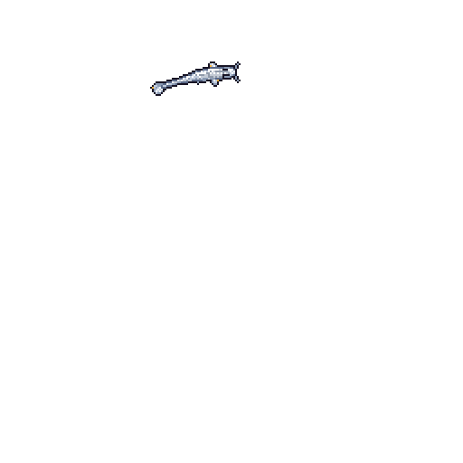

# Hi, I'm BPPE 👋

I make games in Godot — currently building a pinball game.

  

My koi, drawn nightly by
[git-koi](https://github.com/yalongwastaken/git-koi). My languages color it,
my contributions grow it, and the day that just ended decides how it swims.
Right now it wears the color of GDScript, because I make games in Godot.
